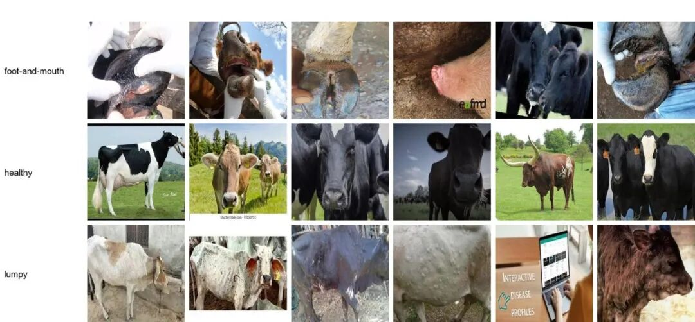
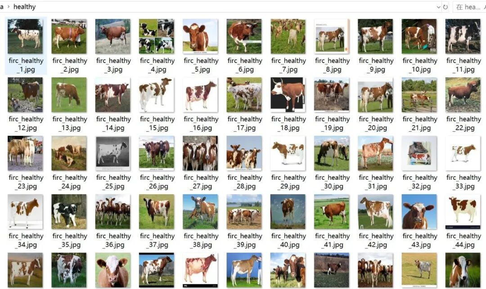
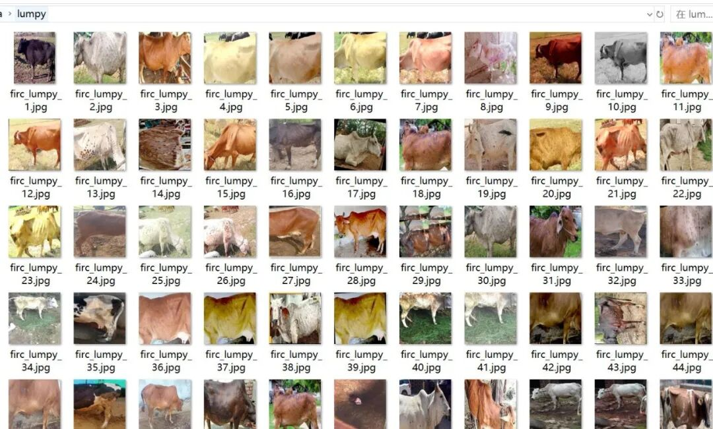
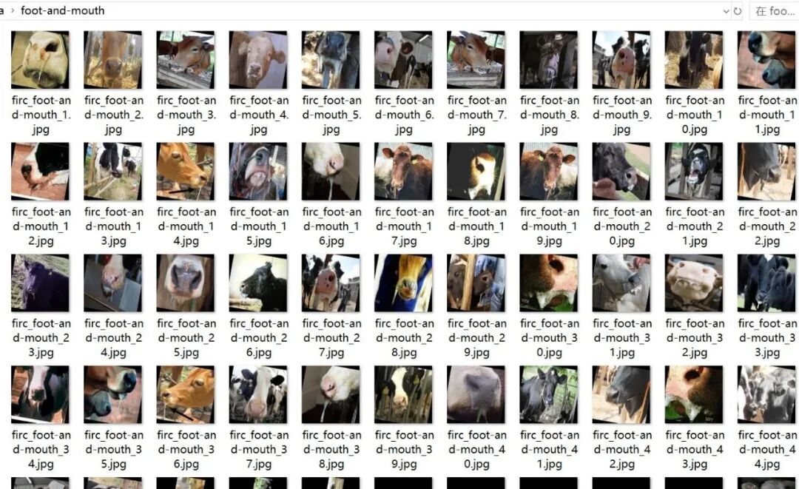

# Intelligent Dairy Beef Skin and Foot Disease Image Classification Dataset: 4428 Images in 3 Categories with Enhanced Features

Dataset type: Image classification, not for object detection without annotations.

Dataset format: Only contains jpg images, each category folder contains the corresponding image.

Number of images (number of jpg files): 4428

Category: 3

Category Name: ["foot-and-mouth", "healthy", "lumpy"]

Number of images per category:

Foot-and-mouth disease (FMD) 745 images

Healthy (health) 1988 images

Lumpiness (nodular dermatitis) 1695 images

Important Notice: No

Special : This dataset does not guarantee the accuracy of the trained models or weight files. The dataset is provided for accurate and reasonable classification storage only.

## Payment

Here is a pay link on Stripe ( https://buy.stripe.com/3cs8yP7sY87d0vu9AB ). Please contact me lonlonago@foxmail.com after funding $89, and I will send you a complete data files , thank you!

